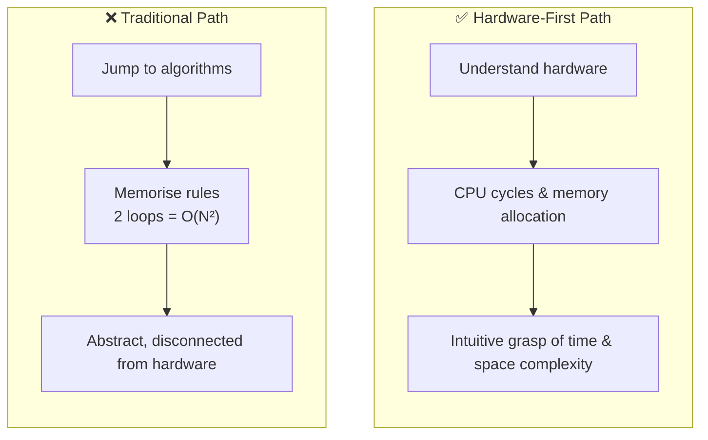
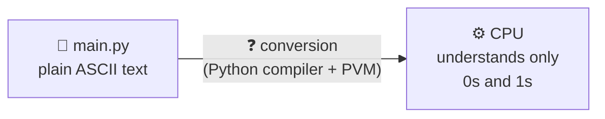
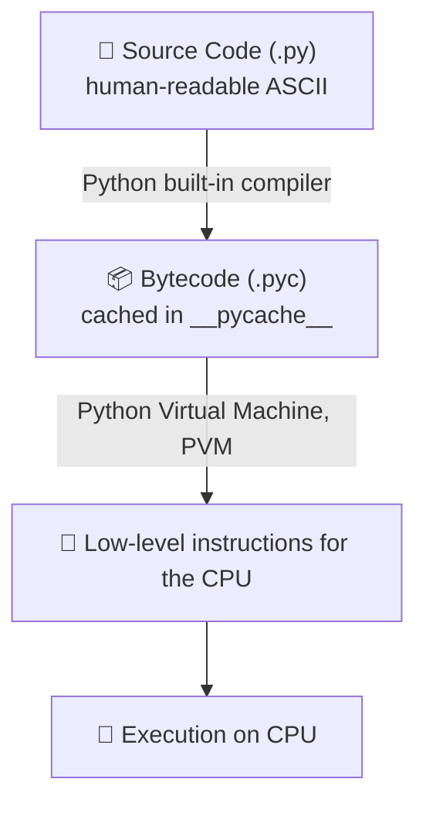
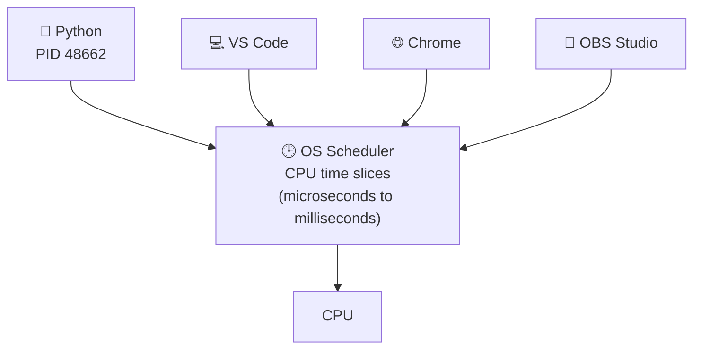
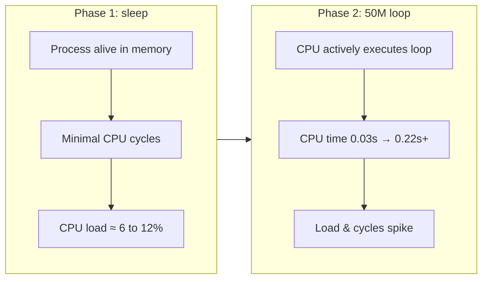
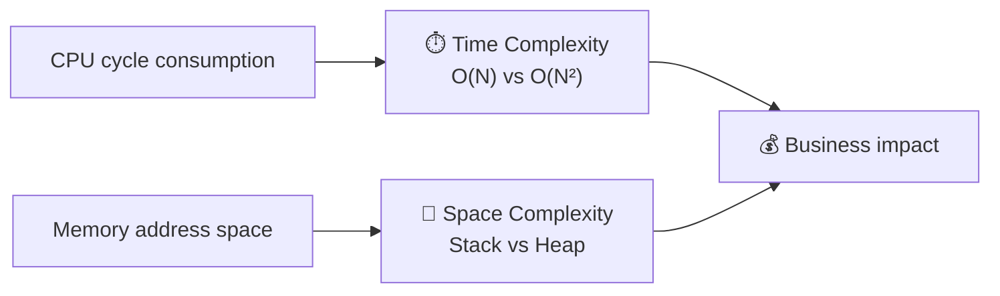
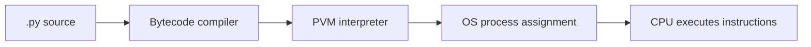
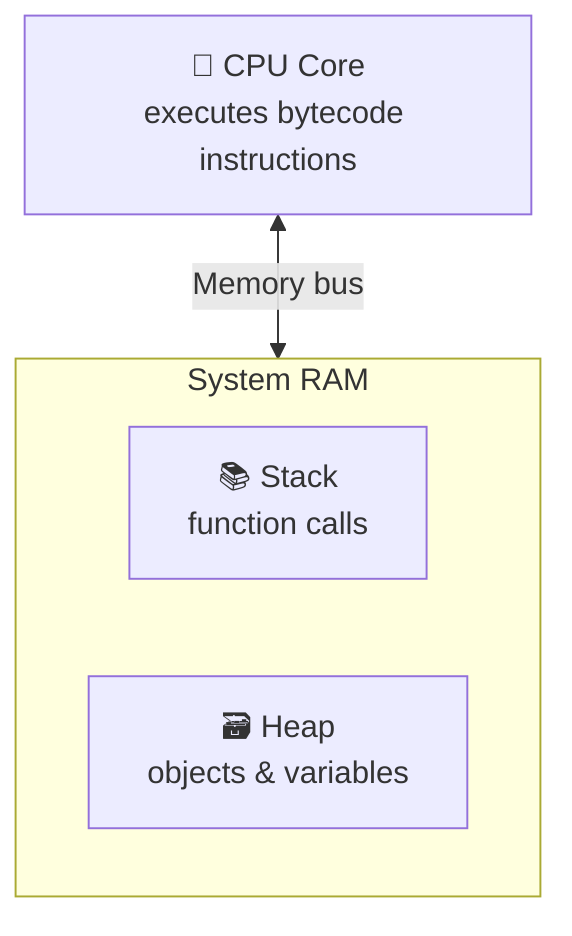

# 🐍 How Python Really Runs: From Source Code to CPU

> **Hardware-first foundations for Data Structures & Algorithms**
> Understand what the machine is actually doing, and Big-O stops being a rule you memorise and becomes something you *see*.

---

## 📑 Table of Contents

1. [Why Hardware Matters](#1--why-hardware-matters)
2. [Source Code vs Binary](#2--source-code-vs-binary)
3. [Python's Compile + Interpret Pipeline](#3--pythons-compile--interpret-pipeline)
4. [Peeking Inside with `dis`](#4--peeking-inside-with-dis)
5. [OS Processes & Context Switching](#5--os-processes--context-switching)
6. [The CPU Stress-Test Experiment](#6--the-cpu-stress-test-experiment)
7. [Linking Hardware to Time & Space Complexity](#7--linking-hardware-to-time--space-complexity)
8. [Memory Foundations & What's Next](#8--memory-foundations--whats-next)
9. [Quick-Revision Cheat Sheet](#9--quick-revision-cheat-sheet)

---

## 1. 🧠 Why Hardware Matters

Most DSA courses start with algorithms and rules. A hardware-first approach starts one layer lower.



### Key ideas

- **The flaw in standard DSA learning:** beginners jump into algorithms, data structures and complexity analysis without knowing how code executes on physical hardware.
- **Everything runs on a server:** frontend or backend, AWS, GCP, or your laptop acting as a server. Many developers ignore this until they reach senior roles.
- **Complexity has physical meaning:**
  - ⏱️ **Time complexity** is bound to CPU work and cycles.
  - 💾 **Space complexity** is bound to physical memory allocation.
- **No more rote learning:** without this intuition you memorise facts like "two nested loops is O(N²)" or "binary search is O(log N)".
- **Advanced topics get easier:** recursion, stack memory and heap memory all make more sense once CPU and memory mechanics are clear.

---

## 2. 📄 Source Code vs Binary



A tiny script such as:

```python
a = 5
b = 10
c = a + b
print(c)
```

is, to the operating system, **just an ASCII text file**.

> ⚠️ **The hardware gap**
> CPUs can't read Python syntax. They only understand binary signals (`0` and `1`).
> **Problem statement:** Python must bridge *high-level ASCII text* → *low-level binary instructions*.

---

## 3. 🔄 Python's Compile + Interpret Pipeline



### 🧩 Python is *both* compiled and interpreted

| Stage | What happens |
|---|---|
| **1. Compile** | The compiler turns `.py` source into intermediate **bytecode** |
| **2. Interpret** | The **PVM** reads the bytecode line by line and drives the CPU |

> 💡 **Contrast with C/C++:** these compile straight to a *native OS executable*. Python bytecode **cannot** be run by the OS directly; it always needs the PVM.

### 🗂️ The caching mechanism (`__pycache__` & `.pyc`)

- When you import a module (e.g. `from helpers import add`), Python generates a `.pyc` file inside a `__pycache__/` folder.
  - Example: `helpers.cpython-313.pyc` (the name encodes Python 3.13).
- `.pyc` files hold **non-human-readable bytes** of the compiled code.
- If the source hasn't changed, Python skips recompilation on later runs, which speeds up large projects.

```text
project/
├── main.py
├── helpers.py
└── __pycache__/
    └── helpers.cpython-313.pyc   👈 auto-generated cache
```

### 🖥️ Role of the PVM

The PVM reads the bytecode, interprets it line by line, and passes low-level instructions to the CPU.

---

## 4. 🔬 Peeking Inside with `dis`

Python ships with a built-in **disassembler** that lets you inspect the bytecode instructions behind your code.

```python
import dis

def add(a, b):
    return a + b

dis.dis(add)
```

### What the output means

| # | Instruction | Meaning |
|:-:|---|---|
| 1 | `RESUME` | Prepares the execution state |
| 2 | `LOAD_FAST a` | Fetches the value of `a` |
| 3 | `LOAD_FAST b` | Fetches the value of `b` |
| 4 | `BINARY_OP` | Performs the addition |
| 5 | `RETURN_VALUE` | Returns the result to the caller |

### Simple function vs loop

| Function | Instruction volume |
|---|---|
| `add(a, b)` | ~4 low-level instructions |
| `find_max(numbers)` | **Far more**: iteration, comparison, loading, storing |

> 🔁 **Loops multiply instructions.** More iterations means more total instructions for the CPU.
> 🏆 **Algorithm comparison rule:** the algorithm that needs *fewer total instructions* is inherently better.

---

## 5. 🧮 OS Processes & Context Switching



- **Process creation:** running `python3 main.py` makes the OS create a dedicated **process** with a unique **PID**.
  ```python
  import os
  print(os.getpid())   # e.g. 48662
  ```
- **Multitasking:** the CPU doesn't run Python exclusively. It rapidly alternates between apps (VS Code, Chrome, OBS, Python…) in microsecond slices. This is **context switching**.
- **Resource management:** the OS allocates CPU cycles, threads and memory, and handles page faults for every active process.
- **Observed in Activity Monitor:**
  - PID (e.g. `48662`)
  - Thread count
  - Real memory footprint (~**10.3 MB**)
  - Context-switch statistics

---

## 6. 🧪 The CPU Stress-Test Experiment

A two-phase script to watch hardware react in an OS monitoring tool.

```python
import time

# 😴 Phase 1: LOW CPU usage
time.sleep(10)          # or time.sleep(60)

# 🔥 Phase 2: HIGH CPU usage
total = 0
for i in range(50_000_000):
    total += 1
```



| Phase | CPU time | System load |
|---|---|---|
| 😴 Sleeping | ~0.03 s | Minimal |
| 🔥 50M loop | 0.22 s+ | Noticeable spike |

> 🎯 **Core insight:** algorithms with redundant operations burn more CPU cycles and more time.

---

## 7. 🔗 Linking Hardware to Time & Space Complexity



### The mapping

| Hardware reality | DSA abstraction |
|---|---|
| CPU cycles consumed | **Time complexity** |
| Memory addresses used | **Space complexity** |

- **Time complexity isn't arbitrary maths.** It represents how many cycles the CPU must run to finish an algorithm.
- **Space complexity** reflects how an algorithm allocates data across physical memory.
- **O(N) beats O(N²) at scale** because instruction counts grow far more slowly, so the hardware doesn't saturate.

### 💸 The financial angle

> In production systems with millions of users, inefficient code becomes **real money lost**.
> Unoptimised code → more CPU cycles → bigger server bills, e.g. **£100 → £200 → £400**.

---

## 8. 🗺️ Memory Foundations & What's Next

### The complete execution pipeline



### The full system view



> The CPU constantly **loads from** and **stores to** memory addresses, so execution can't be understood without understanding memory.

### 🔜 Upcoming topics

- [ ] Stack vs Heap memory in physical RAM
- [ ] How Python variables and objects are allocated on the **heap**
- [ ] How function call frames are managed on the **stack** during **recursion**
- [ ] Combining CPU + memory dynamics to evaluate algorithm efficiency

---

## 9. ⚡ Quick-Revision Cheat Sheet

| Concept | One-line takeaway |
|---|---|
| **Source file** | `.py` is just ASCII text; the CPU can't read it |
| **Bytecode** | Intermediate form produced by Python's compiler |
| **`.pyc` / `__pycache__`** | Cached bytecode that skips recompilation |
| **PVM** | Reads bytecode and drives the CPU |
| **`dis` module** | Shows the low-level instructions behind your code |
| **PID** | The unique ID the OS gives your running process |
| **Context switching** | CPU rapidly alternating between processes |
| **Loops** | Multiply instruction count, so CPU time grows |
| **Time complexity** | = CPU cycles needed |
| **Space complexity** | = memory allocation needed |
| **Why it matters** | Efficient code means lower server cost at scale |

### 🧷 Remember

> **Fewer instructions → fewer CPU cycles → faster code → cheaper servers.**

---

### 🛠️ Try it yourself

```python
import dis, os, time

def find_max(numbers):
    m = numbers[0]
    for n in numbers:
        if n > m:
            m = n
    return m

print("My PID:", os.getpid())
dis.dis(find_max)                 # compare with dis.dis(add)

start = time.process_time()
total = 0
for i in range(50_000_000):
    total += 1
print("CPU time:", round(time.process_time() - start, 2), "s")
```
