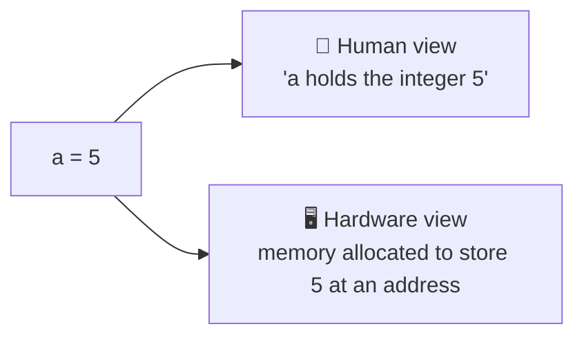
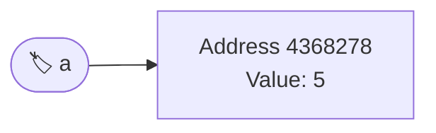
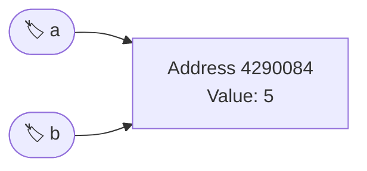
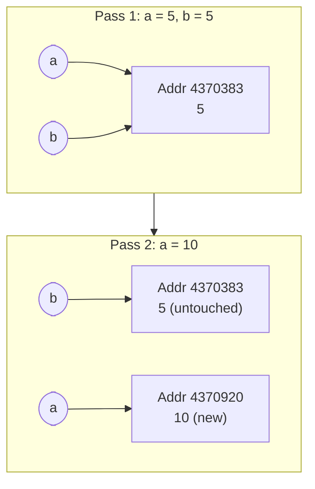
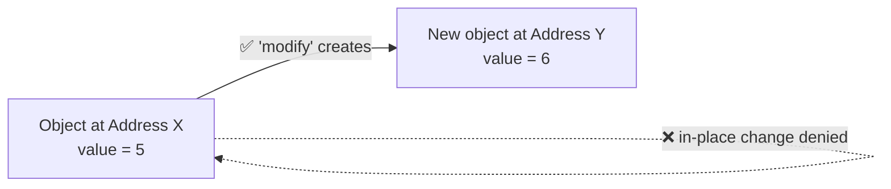
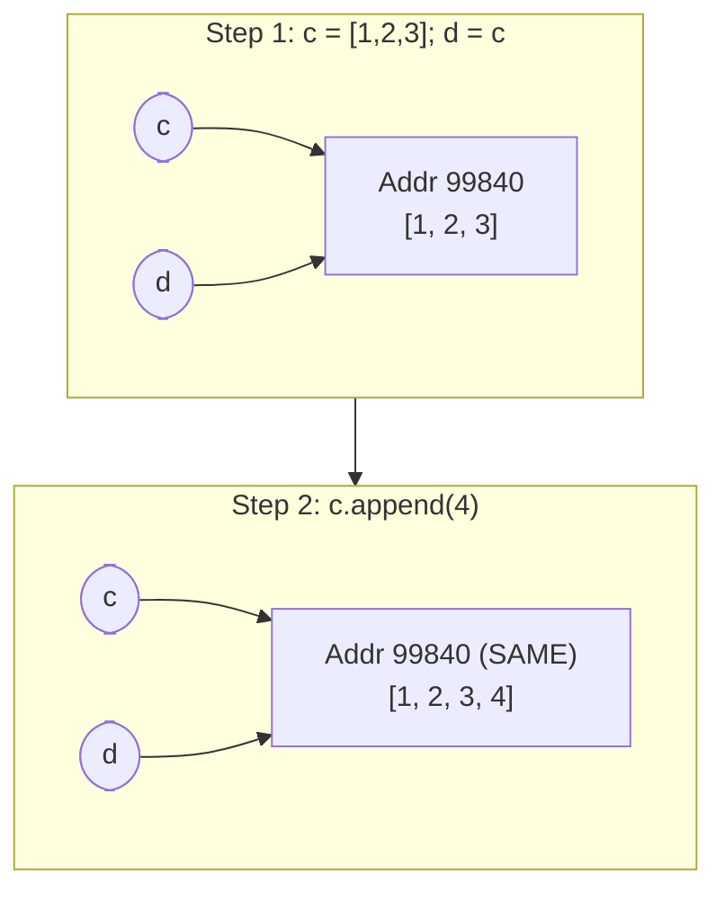

# 🧠 Python Memory Management & Allocation

> **Where do your variables actually live?**
> Names are just labels. Objects live at memory addresses. Once that clicks, mutability, references and garbage collection all make sense.

---

## 📑 Table of Contents

1. [Compute vs Storage](#1--compute-vs-storage)
2. [The Mental Model: RAM as a Building](#2--the-mental-model-ram-as-a-building)
3. [Inspecting Addresses with `id()`](#3--inspecting-addresses-with-id)
4. [Shared References & Integer Interning](#4--shared-references--integer-interning)
5. [Variable Reassignment Mechanics](#5--variable-reassignment-mechanics)
6. [Assignment & Calculations](#6--assignment--calculations-b--a-a--a--1)
7. [Immutable Data Types](#7--immutable-data-types)
8. [Mutable Data Types](#8--mutable-data-types-in-place-modification)
9. [Comparative Summary & Roadmap](#9--comparative-summary--roadmap)
10. [Quick-Revision Cheat Sheet](#10--quick-revision-cheat-sheet)

---

## 1. ⚖️ Compute vs Storage

Every server or machine relies on two fundamental resources:

| Resource | Role | Hardware |
|---|---|---|
| ⚙️ **Compute** | Executes instructions and algorithms | CPU cycles |
| 💾 **Memory / Storage** | Retains values and state while the program runs | RAM |



- Humans read `a = 5` easily, but Python must **store `5` in physical memory** so it can be fetched whenever `a` is used later.
- **Core questions of memory allocation:**
  - 📌 How is memory allocated?
  - 📏 How much space does each data type consume?
  - 🔀 When do memory locations change?
  - ♻️ When is memory released back to the system?

---

## 2. 🏢 The Mental Model: RAM as a Building

Think of RAM as a **huge building with millions of uniquely numbered rooms**.

| Room 101 | Room 102 | Room 103 | Room 104 |
|:-:|:-:|:-:|:-:|
| Address `001` | Address `002` | Address `003` | Address `004` |
| *(empty)* | *(empty)* | *(empty)* | **Value: `5`** ⬅️ label `a` |

- **RAM = building**, with every slot identified by a unique **memory address** (Room ID).
- **Variables = labels (pointers).** After `a = 5`, the value `5` lives in some room (e.g. address `4368278`) and `a` is just a human-readable name pointing there.
- Python tracks **addresses**, not variable names, during execution.

> 💡 **Mental shift:** a variable is *not* a box that contains a value. It is a **name tag attached to an object** that lives elsewhere.



---

## 3. 🔍 Inspecting Addresses with `id()`

Python's built-in `id()` reveals the address of any object.

```python
a = 5
b = 10
c = "hello"
d = [1, 2, 3]

print(id(a))   # e.g. 4368278  (int)
print(id(b))   # e.g. 4368358  (int)
print(id(c))   # e.g. 4369120  (str)
print(id(d))   # e.g. 4370540  (list)
```

| Variable | Type | Example `id()` |
|---|---|---|
| `a = 5` | `int` | `4368278` |
| `b = 10` | `int` | `4368358` |
| `c = "hello"` | `str` | `4369120` |
| `d = [1, 2, 3]` | `list` | `4370540` |

- Different objects get **distinct addresses** across RAM.
- `id()` is a great **debugging and visualisation tool**: trace allocations, verify shared references, and stop guessing.

> 📝 The exact numbers differ on every machine and every run. Only the *relationships* (same or different) matter.

---

## 4. 🔗 Shared References & Integer Interning

```python
a = 5
b = 5
print(id(a) == id(b))   # True ✅
```



- Two variables assigned the same primitive value can point to the **exact same address**.
- **Memory saving:** 10 variables set to `5` → **1** memory location, not 10.
- This optimisation is called **interning**: commonly used values are cached at fixed locations so every variable referencing them shares one object.

> ⚠️ **Accuracy note:** in CPython, small integers from **-5 to 256** are cached. The source mentions "up to 256 or 1000"; treat **256** as the reliable boundary. Never rely on `is`/`id()` equality for numbers in your logic. Use `==` for value comparison.

---

## 5. 🔄 Variable Reassignment Mechanics

```python
a = 5
b = 5
a = 10
```



- Reassigning `a = 10` does **not** overwrite the value at the old address.
- Python **creates a new object** (`10`) at a **new address** and re-points `a` to it.
- `b` still points to `5` at the original address.
- The original `5` **persists in RAM as long as at least one variable references it**.

---

## 6. ➕ Assignment & Calculations (`b = a`, `a = a + 1`)

```python
a = 5
b = a        # Step 1: reference copy
a = a + 1    # Step 2: arithmetic reassignment
```

| Step | `a` | `b` | What happened |
|---|---|---|---|
| `a = 5` | → addr `5000` (5) | n/a | `5` stored, `a` points to it |
| `b = a` | → addr `5000` (5) | → addr `5000` (5) | `b` copies the **reference**, not the value |
| `a = a + 1` | → addr `5064` (6) | → addr `5000` (5) | `a` migrates to a new object; `b` is unchanged |

**How `a = a + 1` is evaluated:**

1. 🧮 Python evaluates `a + 1` → computes `6`.
2. 🆕 Since integers are **immutable**, it allocates a **new** address for `6` and redirects `a`.
3. 🔒 `b` stays bound to `5` at the original address.

> 🎯 `b = a` copies the **address**, not the object.

---

## 7. 🔒 Immutable Data Types

> An object is **immutable** if its value **cannot be changed in-place** at its existing address.



- Any operation that *appears* to change an immutable variable builds a **brand-new object** at a **different address**.

### Immutable types

| Type | Example |
|---|---|
| `int` | `5` |
| `float` | `3.14` |
| `str` | `"hello"` |
| `bool` | `True` |
| `tuple` | `(1, 2, 3)` |
| `None` | `None` |

```python
s = "hello"
print(id(s))
s = s + " world"      # creates a NEW string
print(id(s))          # different address 🔀
```

> ⚠️ **Subtle point:** a tuple is immutable, but if it *contains* a mutable object (like a list), that inner object can still change. The tuple's own structure (which objects it references) cannot.

---

## 8. ✏️ Mutable Data Types (In-Place Modification)

> An object is **mutable** if its contents can be changed **in-place**, at the **same address**.

```python
c = [1, 2, 3]
d = c                 # d points to the SAME list
c.append(4)

print(c)              # [1, 2, 3, 4]
print(d)              # [1, 2, 3, 4]  😮 d changed too!
print(id(c) == id(d)) # True
```



- `c.append(4)` modifies the list **right where it lives**, so no address change.
- Both `c` and `d` see the update because they share one object.

### Mutable types

| Type | Example |
|---|---|
| `list` | `[1, 2, 3]` |
| `dict` | `{"a": 1}` |
| `set` | `{1, 2, 3}` |

> 🧯 **Gotcha:** if you want an independent copy, use `d = c.copy()` (or `list(c)` / `c[:]`). Plain `d = c` only copies the reference.

---

## 9. 📊 Comparative Summary & Roadmap

| Category | Data types | When "changed" |
|---|---|---|
| 🔒 **Immutable** | `int`, `float`, `str`, `bool`, `tuple`, `None` | **New address** assigned |
| ✏️ **Mutable** | `list`, `dict`, `set` | **Same address** retained |

> 🔑 **Key takeaway:** primitive types redirect variables to new addresses upon modification, while collections (`list`, `dict`, `set`) change in place at their existing address.

### 🔜 Upcoming topics in the series

- [ ] **Memory sizing:** exact byte consumption of different data types
- [ ] **Stack vs Heap:** function frames (stack) vs object allocation (heap)
- [ ] **Memory deallocation:** reference counting and garbage collection

---

## 10. ⚡ Quick-Revision Cheat Sheet

| Concept | One-line takeaway |
|---|---|
| **Compute vs storage** | CPU runs instructions; RAM holds state |
| **Memory address** | The unique "room number" of an object in RAM |
| **Variable** | A label pointing to an address, not a container |
| **`id(x)`** | Shows the address of the object `x` refers to |
| **Interning** | Common values (e.g. small ints) share one object |
| **Reassignment** | Creates a new object and re-points the name |
| **`b = a`** | Copies the reference, not the object |
| **Immutable** | Change → new object, new address |
| **Mutable** | Change → same object, same address |
| **Aliasing risk** | Mutating a shared mutable object affects every name pointing to it |

### 🧷 Remember

> **Names point to objects. Immutable objects are replaced; mutable objects are modified.**

---

### 🛠️ Try it yourself

```python
# Immutable: new address on change
a = 5
b = a
print(id(a) == id(b))      # True
a = a + 1
print(id(a) == id(b))      # False

# Mutable: same address on change
c = [1, 2, 3]
d = c
c.append(4)
print(id(c) == id(d))      # True
print(d)                   # [1, 2, 3, 4]

# Tuples and dicts
t = (1, 2, 3)
print(id(t)); t += (4,); print(id(t))   # changes (new tuple)

m = {"x": 1}
print(id(m)); m["y"] = 2; print(id(m))  # same (in place)
```
