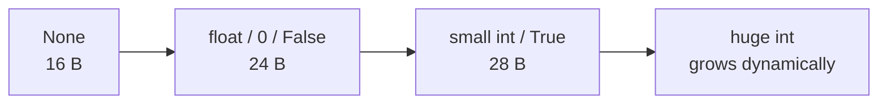
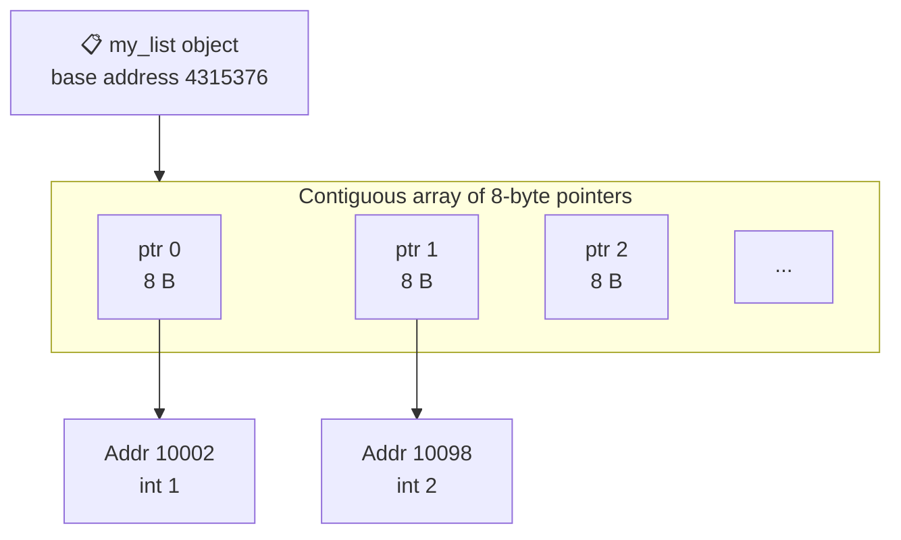
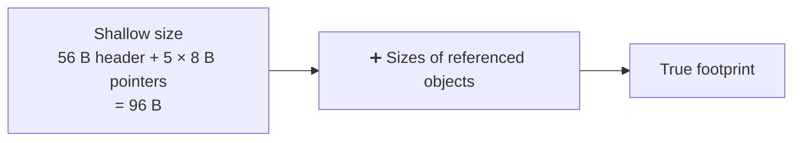
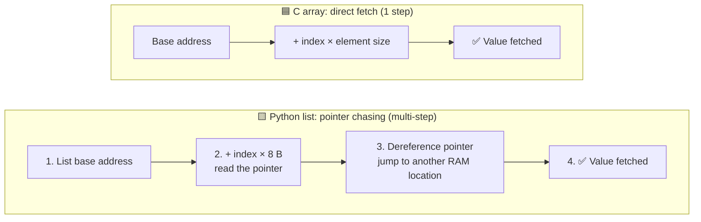
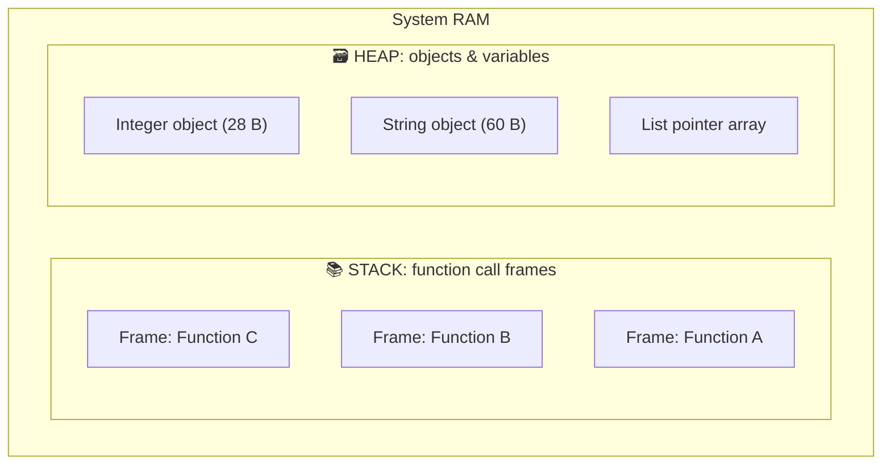

# 📏 Python Memory Sizing, Containers & Pointer References

> **Episode 3:** How many bytes does an object really cost, and why does a Python list behave differently from a C array?

---

## 📑 Table of Contents

1. [Measuring Memory with `sys.getsizeof`](#1--measuring-memory-with-sysgetsizeof)
2. [Memory Overhead of Strings](#2--memory-overhead-of-strings)
3. [List Architecture: The Reference Pointer Model](#3--list-architecture-the-reference-pointer-model)
4. [Greedy Over-Allocation in Lists](#4--greedy-over-allocation-in-lists)
5. [Shallow Size vs True Memory Footprint](#5--shallow-size-vs-true-memory-footprint)
6. [CPU Trade-off: Why Python Is Slower Than C](#6--cpu-trade-off-why-python-is-slower-than-c)
7. [Roadmap: Stack vs Heap](#7--roadmap-stack-vs-heap)
8. [Quick-Revision Cheat Sheet](#8--quick-revision-cheat-sheet)

---

## 1. 📐 Measuring Memory with `sys.getsizeof`

```python
import sys
sys.getsizeof(obj)   # → memory used by obj, in bytes
```

### Primitive sizes

| Object | Call | Size | Note |
|---|---|:-:|---|
| `None` | `sys.getsizeof(None)` | **16 B** | NoneType object |
| Float | `sys.getsizeof(3.14)` | **24 B** | Constant for normal floats |
| Bool `False` | `sys.getsizeof(False)` | **24 B** | Represents `0` |
| Bool `True` | `sys.getsizeof(True)` | **28 B** | Represents `1` |
| Int `0` | `sys.getsizeof(0)` | **24 B** | Base object overhead |
| Int `5` | `sys.getsizeof(5)` | **28 B** | Small integers |
| Int `10**1000` | `sys.getsizeof(10**1000)` | **Much larger** | Grows with the number |

### Key ideas

- 📦 **Integers are objects, not fixed-width primitives.** There is no 32-bit or 64-bit limit. Python stores big numbers by adding more digit storage, so `10**1000` needs far more than 28 bytes.
- 🧱 **Base overhead:** `0` costs 24 B just for the object header; typical small ints like `5` cost 28 B.
- 🖥️ **Architecture dependent:** exact sizes (24 vs 28, etc.) vary with the system (32-bit vs 64-bit) and Python version. The numbers above are typical for 64-bit CPython.
- 🔘 **Booleans:** `False` maps to `0` and `True` maps to `1`, so they take 24 B and 28 B like those integers.
- ⭕ **`None`** needs 16 B.



---

## 2. 🔤 Memory Overhead of Strings

Strings are **containerised** objects, so their size scales with their length.

| String | Characters | Size | Calculation |
|---|:-:|:-:|---|
| `""` | 0 | **49 B** | Base overhead |
| `"a"` | 1 | **50 B** | 49 + 1 |
| `"Hello World"` | 11 | **60 B** | 49 + 11 |

> 🧮 **Formula:** `Total memory = 49 B (base overhead) + number of characters` (for ASCII text)

- The **49 B base** holds metadata, encoding information and the object header.
- Each extra ASCII character adds **1 byte**.

> ⚠️ **Accuracy note:** this formula holds for plain ASCII/Latin-1 strings. Strings with wider characters (e.g. emoji or many non-Latin scripts) use 2 or 4 bytes per character.

---

## 3. 🧩 List Architecture: The Reference Pointer Model

### ❌ The flawed mental model

```text
my_list ─► [ Addr 100: value 1 ][ Addr 104: value 2 ]   ← values stored inline (WRONG)
```

### ✅ How Python really does it



### The "address gap mystery"

Compare the address of the list with the address of one of its elements:

```python
my_list = [1, 2, 3, 4, 5]
print(id(my_list))      # e.g. 4315376
print(id(my_list[0]))   # e.g. 10002 … a totally different region of RAM
```

The huge gap shows that **elements are not stored inside the list's own block**.

> 📝 The source text compares `id(my_list)` to itself. The meaningful comparison is the list's `id` vs. the `id` of its **elements**.

### Facts

- 🪶 An empty list `[]` costs **56 B** base overhead.
- 🎯 A list stores a **contiguous array of 8-byte pointers (references)**, not raw values.
- ➕ Each element adds **one 8-byte pointer** to that array.
- 🗃️ The actual objects live elsewhere in RAM.

---

## 4. 📈 Greedy Over-Allocation in Lists

| Elements | `sys.getsizeof()` | Meaning |
|:-:|:-:|---|
| 0 | **56 B** | Base overhead |
| 1 | **64 B** | +8 B (1 pointer) |
| 3 | **80 B** | +24 B (3 pointers) |
| 5 | **96 B** | +40 B (5 pointers) |
| 10 | **136 B** | +80 B (10 pointers) |
| 100 | **856 B** | 56 + 100 × 8 |

> **Formula (list literal):** `56 B + 8 B × n`

### Why Python over-allocates

- 🐌 If every `append()` grew memory by exactly 8 B, each call would trigger a costly CPU/OS **reallocation**.
- 🚀 So Python **greedily over-allocates**: it reserves spare pointer slots in chunks, betting you'll add more.
- 🔒 As a result, `sys.getsizeof()` often **doesn't change** after an append, because a reserved slot is already available.

```python
import sys
lst = []
prev = sys.getsizeof(lst)
for i in range(20):
    lst.append(i)
    size = sys.getsizeof(lst)
    if size != prev:
        print(f"len={len(lst):>2} → {size} B  (jumped by {size - prev})")
        prev = size
```

> ⚠️ **Accuracy note:** the table above matches lists **created as literals** (`[1, 2, 3]`), which are sized exactly. Lists **grown with `append()`** are over-allocated, so their sizes jump in steps (for example, after the first append CPython typically shows 88 B, not 64 B). Run the script above to see the pattern on your own machine.

---

## 5. 🔎 Shallow Size vs True Memory Footprint

```python
my_list = [1, 2, 3, 4, 5]
sys.getsizeof(my_list)   # 96 B  ← SHALLOW size only
```



### Calculation

| Part | Size |
|---|---|
| Shallow list (56 B + 5 × 8 B) | **96 B** |
| 5 integer objects (5 × 28 B) | **140 B** |
| **True total** | **236 B** |

> 🧮 **`True memory = shallow size + Σ(size of each referenced object)`**

- `sys.getsizeof()` returns the **shallow size**: the container header plus the pointer array.
- It **does not follow the pointers** to measure the objects they reference.
- To know the real RAM cost of a container, add the referenced objects' sizes yourself.

> 💡 **Nuance:** objects referenced more than once (or cached, like small integers) are shared in memory, so naively adding sizes can overcount.

---

## 6. ⚙️ CPU Trade-off: Why Python Is Slower Than C



| | **C array** | **Python list** |
|---|---|---|
| Storage | Raw values side by side | Array of 8-byte pointers |
| Access | `Base + Index × Size` | Offset → read pointer → follow pointer |
| Memory fetches | **1** | **2+** |
| Result | ⚡ Fast | 🐢 Extra CPU cycles |

> 🎯 This **extra level of indirection** is one reason Python is slower than compiled languages such as C. Flexibility (a list can hold anything) costs cycles.

---

## 7. 🗺️ Roadmap: Stack vs Heap



- 🧱 **RAM is segmented**, mainly into **Stack** and **Heap**.
- 📚 **Stack:** tracks active function frames and nested calls (`A()` → `B()` → `C()`).
- 🗃️ **Heap:** holds dynamic objects, variables and data-structure references created at runtime.
- 🔁 Knowing how frames pile up on the stack is the foundation for **recursion** and for understanding **stack overflow**.

### 🔜 Up next

- [ ] How the stack and heap handle function call frames
- [ ] Recursion and call-stack growth
- [ ] Hands-on sizing of strings and lists on your own machine

---

## 8. ⚡ Quick-Revision Cheat Sheet

| Concept | One-line takeaway |
|---|---|
| `sys.getsizeof(x)` | Bytes used by `x` (shallow) |
| `None` | 16 B |
| float | 24 B |
| int | 24 B (zero), 28 B (small), grows with magnitude |
| bool | `False` 24 B, `True` 28 B |
| str | 49 B + 1 B per ASCII char |
| empty list | 56 B |
| list | 56 B + 8 B per element (pointers only) |
| Over-allocation | Spare slots reserved so `append` stays fast |
| Shallow vs true size | True = shallow + referenced objects |
| List access | Index → pointer → object (indirection) |
| C array access | Base + index × size (direct) |
| Stack | Function call frames |
| Heap | Objects and data |

### 🧷 Remember

> **A Python list holds addresses, not values.** That flexibility costs extra memory *and* extra CPU steps.

---

### 🛠️ Try it yourself

```python
import sys

# Primitives
for obj in (None, 3.14, False, True, 0, 5, 10**1000):
    print(f"{repr(obj)[:12]:<14} {sys.getsizeof(obj)} B")

# Strings: 49 + length
for s in ("", "a", "Hello World"):
    print(f"{s!r:<15} {sys.getsizeof(s)} B")

# Lists: shallow vs true size
my_list = [1, 2, 3, 4, 5]
shallow = sys.getsizeof(my_list)
true = shallow + sum(sys.getsizeof(x) for x in my_list)
print("shallow:", shallow, "| true:", true)

# Address gap: list vs its elements
print(id(my_list), id(my_list[0]))
```
