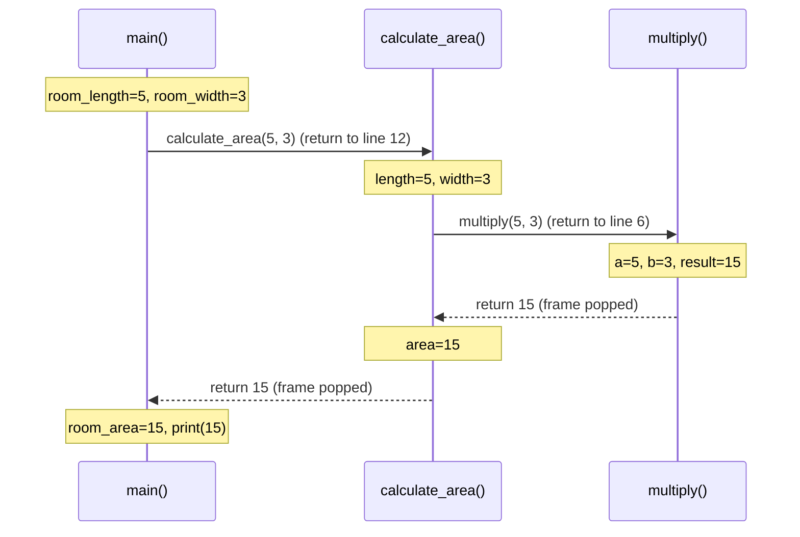
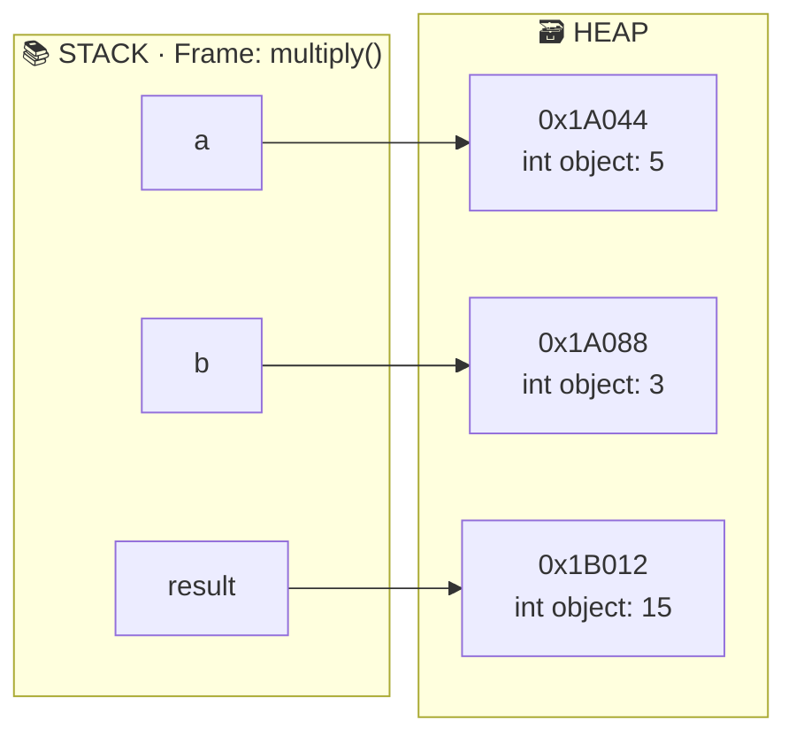
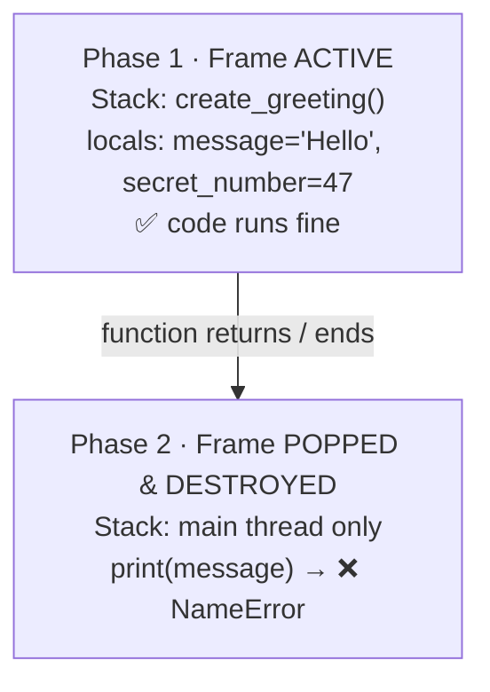

# 📚 Python Stack Memory, Call Frames & Variable Lifecycles

> **Episode 4:** How does Python remember where it is when functions call other functions, and why do local variables vanish?

---

## 📑 Table of Contents

1. [Beyond a Flat Block of RAM](#1--beyond-a-flat-block-of-ram)
2. [Mental Model: The Single-Function Tracing Game](#2--mental-model-the-single-function-tracing-game)
3. [The Stack & the Plate Analogy (LIFO)](#3--the-stack--the-plate-analogy-lifo)
4. [Stack vs Heap: References vs Values](#4--stack-vs-heap-references-vs-values)
5. [Inspecting the Call Stack with `traceback`](#5--inspecting-the-call-stack-with-traceback)
6. [Frame-Level Scope & Variable Isolation (`inspect`)](#6--frame-level-scope--variable-isolation-inspect)
7. [Frame Lifecycle & the `NameError`](#7--frame-lifecycle--the-nameerror)
8. [Summary & Roadmap](#8--summary--roadmap)
9. [Quick-Revision Cheat Sheet](#9--quick-revision-cheat-sheet)

---

## 1. 🧱 Beyond a Flat Block of RAM

**Question:** is system memory just one big, unstructured block?
**Answer:** no. RAM is organised into specialised zones.

| 📚 Stack Memory | 🗃️ Heap Memory |
|---|---|
| Manages function execution | Stores the actual values and data |
| Tracks call frames and scope | Unorganised object storage |
| Manages return addresses | Accessed through references |

### Why we need this

- 🔗 So far: CPU execution → memory allocation → data-structure sizing. Now we look at **how RAM is structured**.
- 🧩 **The function execution problem:** with nested calls, the runtime needs a dedicated mechanism to remember **local variables**, **execution state** and **exact return points**.
- 🔁 **Foundation for recursion:** good algorithm design (especially recursion in DSA) depends on how **function frames stack and unstack** in memory.

---

## 2. 🎮 Mental Model: The Single-Function Tracing Game

> **Rule of the game:** imagine the interpreter can focus on **only one function at a time**.
> Every active call gets its own **sticky note** with:
> 📝 its local parameters and variables · 📍 the line to return to when finished.

### Example program flow

```python
def multiply(a, b):
    result = a * b
    return result                      # returns 15

def calculate_area(length, width):
    area = multiply(length, width)     # line 6
    return area

def main():
    room_length = 5
    room_width = 3
    room_area = calculate_area(room_length, room_width)   # line 12
    print(room_area)                   # 15

main()
```

### Step-by-step trace



| Step | Active function | What happens |
|:-:|---|---|
| 1 | `main()` | Records `room_length = 5`, `room_width = 3` |
| 2 | `main()` ⏸️ | Calls `calculate_area(5, 3)`, saving **line 12** as the return point |
| 3 | `calculate_area()` | Receives `length = 5`, `width = 3`, then calls `multiply(5, 3)` and saves **line 6** |
| 4 | `multiply()` | Computes `result = 5 × 3 = 15` and runs `return 15` |
| 5 | `calculate_area()` | `multiply`'s note is **discarded**; resumes at line 6, `area = 15`, returns `15` |
| 6 | `main()` | Resumes at line 12, `room_area = 15`, prints `15`, finishes |
| 7 | OS | Control returns to the main process thread |

---

## 3. 🍽️ The Stack & the Plate Analogy (LIFO)

```text
        ┌──────────────────────────────┐
  TOP → │ multiply()        ▶ running  │   ← newest plate
        ├──────────────────────────────┤
        │ calculate_area()  ⏸ line 6   │
        ├──────────────────────────────┤
 BOTTOM │ main()            ⏸ line 12  │   ← oldest plate
        └──────────────────────────────┘
```

> **LIFO: Last-In, First-Out.** The newest plate on top is the first one removed.

| Operation | When it happens |
|---|---|
| ⬆️ **PUSH** | A function is called → a new frame goes on top |
| ⬇️ **POP** | A function hits `return` or finishes → its frame is removed, and execution resumes in the frame below |

- 📌 **Stack memory** = the partition that tracks active calls, local variables, scopes and return lines.
- 🔒 **Scope preservation:** `length` in `calculate_area` and `a` in `multiply` live in **separate frames**, so there are no name collisions.

---

## 4. 🔀 Stack vs Heap: References vs Values



| | 📚 Stack | 🗃️ Heap |
|---|---|---|
| **Holds** | Frames, variable names, **references** | Actual **values and objects** |
| **Organisation** | Strict, ordered (LIFO) | Unorganised; space wherever RAM is free |
| **Role** | Order of execution, scope, lifetimes | Data storage |

- Variable names in a frame (`a = 5`, `b = 3`) **don't hold the value**. They hold **addresses** pointing into the heap.
- The stack handles *when and where*; the heap handles *what*.

> ⚠️ **Accuracy note:** this is the right *conceptual* model for DSA and recursion. Internally, CPython's frames are managed by the interpreter (and small integers like `5`, `3` are shared cached objects), but the idea of "frames hold references; objects live elsewhere" is exactly how Python behaves.

---

## 5. 🔍 Inspecting the Call Stack with `traceback`

Python's built-in `traceback` module can print the **live call stack** at any moment.

```python
import traceback

def process_order(order_id):
    traceback.print_stack()           # line 6: show the live call stack

def validate_order(order_id):
    process_order(order_id)           # line 11

def receive_order(order_id):
    validate_order(order_id)          # line 16

receive_order(47)                     # line 20 (main module)
```

### What the stack looks like at `print_stack()`

| Order | Frame | Line | Action |
|:-:|---|:-:|---|
| ① bottom | `main.py` (module) | 20 | Calls `receive_order(47)` |
| ② | `receive_order()` | 16 | Calls `validate_order(47)` |
| ③ | `validate_order()` | 11 | Calls `process_order(47)` |
| ④ top | `process_order()` | 6 | Runs `traceback.print_stack()` |

### Unwinding order

1. ✅ `process_order()` finishes → **pops**
2. ↩️ Back to line 11 in `validate_order()` → finishes → **pops**
3. ↩️ Back to line 16 in `receive_order()` → finishes → **pops**
4. ↩️ Back to line 20 in `main.py` → main thread resumes

> 💡 Every error **traceback** you've ever seen is this same call stack printed at the moment of failure.

---

## 6. 🔐 Frame-Level Scope & Variable Isolation (`inspect`)

`inspect.currentframe().f_locals` reveals the **exact dictionary of local variables** in a frame.

```python
import inspect

def calculate_tax(price, tax_rate):
    tax_amount = price * tax_rate / 100
    print(inspect.currentframe().f_locals)
    return tax_amount
```

### Each frame has its own private world

| Frame | Locals | Can it see the others' variables? |
|---|---|---|
| `calculate_tax` | `{price: 500, tax_rate: 18, tax_amount: 90}` | ❌ Not `create_invoice` or `handle_purchase` |
| `create_invoice` | `{item_name: 'Laptop', item_price: 500}` | ❌ Not `tax_amount` from `calculate_tax` |
| `handle_purchase` | `{customer_name: 'Rahul', price: 50000, item: 'Laptop'}` | ❌ Its sub-functions can't see these |

- **Parameter passing** copies **references** into the new frame's locals. The data crosses the boundary only through arguments and return values.
- This strict isolation is what makes functions safe, reusable building blocks.

---

## 7. 💀 Frame Lifecycle & the `NameError`

```python
def create_greeting():
    message = "Hello"
    secret_number = 47
    print(message, secret_number)     # ✅ works inside the function

create_greeting()
print(message)                        # ❌ NameError: name 'message' is not defined
```



> 📜 **The variable lifetime rule:** a local variable exists **only while its function's frame is on the call stack.**

1. `create_greeting()` runs and creates `message` and `secret_number` in its frame.
2. Its `print` shows both values correctly.
3. On completion, the frame is **popped and destroyed**.
4. Outside, `message` and `secret_number` no longer exist → **`NameError`**.

> 💡 **Nuance:** the *names* vanish with the frame. The *objects* on the heap are only freed when nothing else references them (more on that in the heap episode). A function can also `return` a value to keep its result alive.

---

## 8. 🏁 Summary & Roadmap

### 🏛️ Three pillars of stack memory

| # | Pillar | Meaning |
|:-:|---|---|
| 1 | **LIFO call stack** | Manages call order, frames and return lines |
| 2 | **Isolated scopes** | Private, per-frame local variables (stored as references) |
| 3 | **Automatic lifecycle** | Frames created on call, destroyed on return |

### 🔜 Up next: Heap Memory

- [ ] How objects are allocated and deallocated in heap RAM
- [ ] Garbage collection: **reference counting** and **generational GC**
- [ ] Combining **CPU cycles + stack + heap** for hardware-grounded DSA analysis

---

## 9. ⚡ Quick-Revision Cheat Sheet

| Concept | One-line takeaway |
|---|---|
| **Stack** | Tracks active function calls, scopes and return points |
| **Heap** | Stores the real objects and values |
| **Frame ("sticky note")** | One per call: locals + return line |
| **LIFO** | Last frame pushed is the first popped |
| **Push / Pop** | Call = push, return = pop |
| **Frame holds** | References, not values |
| **`traceback.print_stack()`** | Prints the live call stack |
| **`inspect.currentframe().f_locals`** | Shows a frame's local variables |
| **Scope isolation** | A function can't see another function's locals |
| **`NameError`** | You used a name whose frame is gone |
| **Recursion link** | Each recursive call pushes a new frame |

### 🧷 Remember

> **Every call pushes a frame; every return pops one. Locals live and die with their frame.**

---

### 🛠️ Try it yourself

```python
import traceback, inspect, sys

# 1. Watch the live stack
def process_order(order_id):
    traceback.print_stack()

def validate_order(order_id):
    process_order(order_id)

def receive_order(order_id):
    validate_order(order_id)

receive_order(47)

# 2. Peek at a frame's locals
def calculate_tax(price, tax_rate):
    tax_amount = price * tax_rate / 100
    print("locals:", inspect.currentframe().f_locals)
    return tax_amount

calculate_tax(500, 18)

# 3. Locals die with the frame
def create_greeting():
    message = "Hello"
    return None

create_greeting()
try:
    print(message)
except NameError as e:
    print("NameError:", e)

# 4. Bonus: stack depth is limited (foreshadows recursion!)
print("Recursion limit:", sys.getrecursionlimit())   # typically 1000
```
