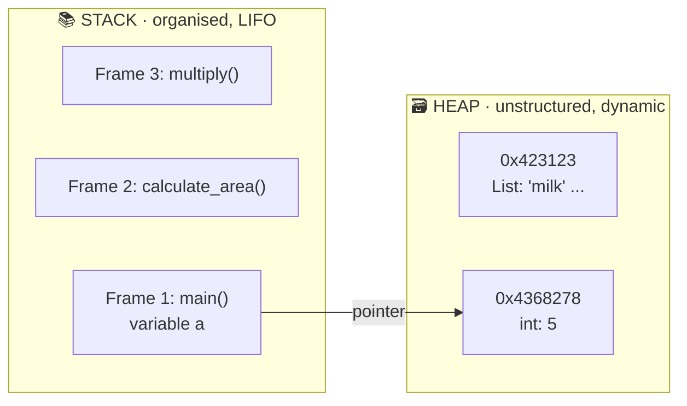
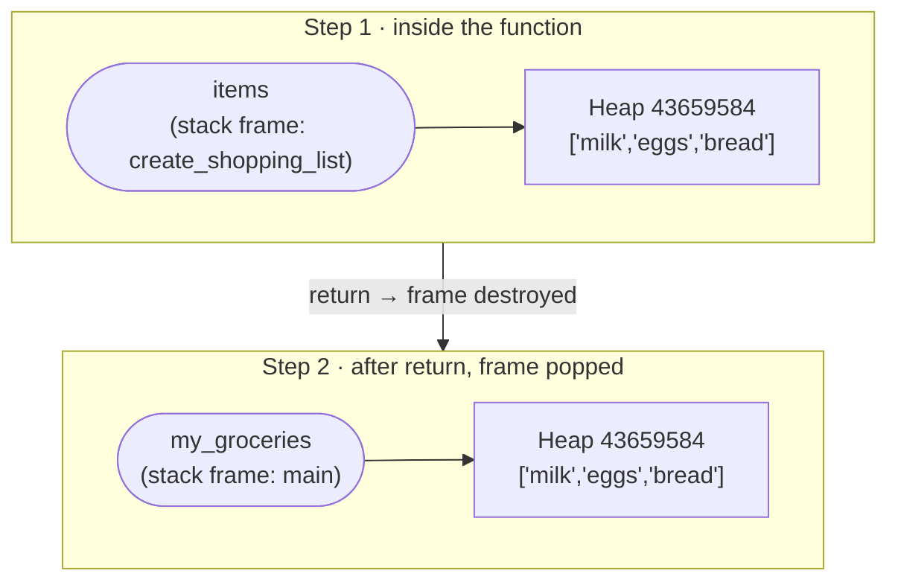
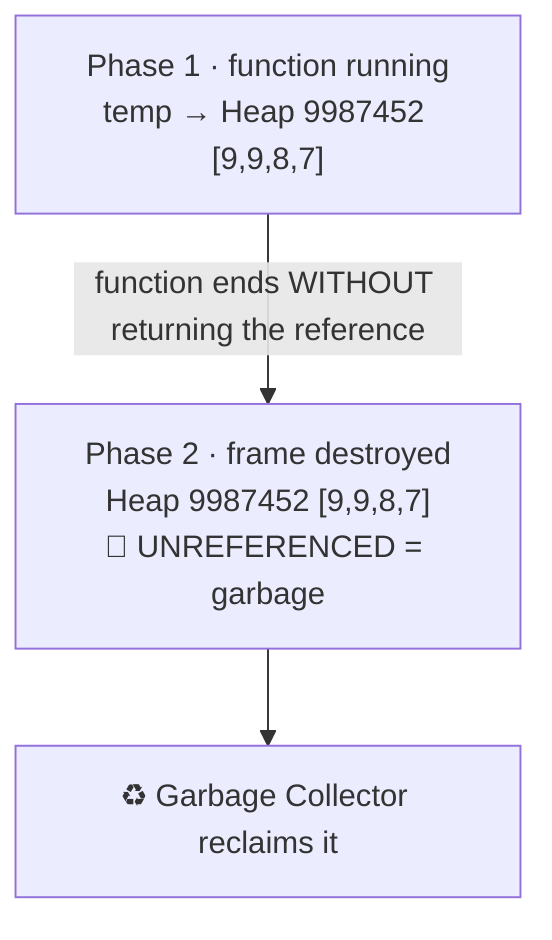
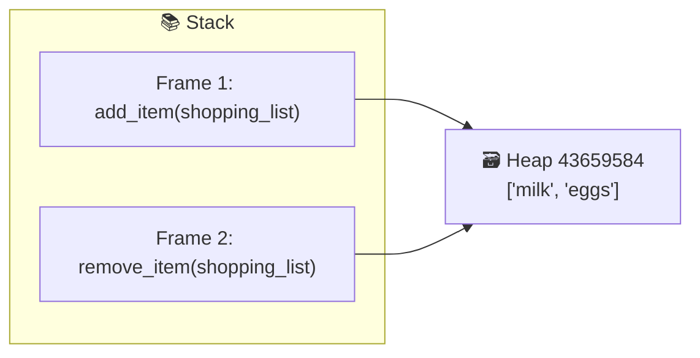
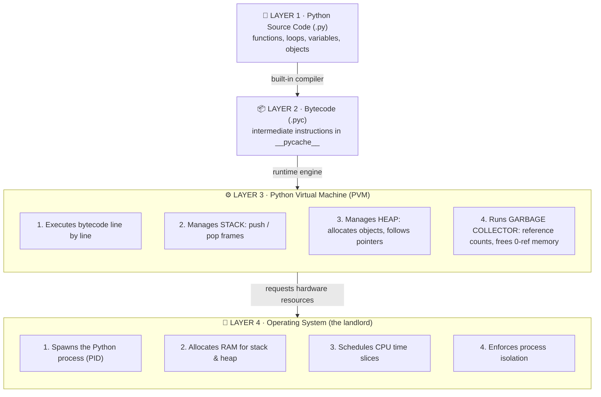

# 🗃️ Python Heap Memory, Reference Counting & Garbage Collection

> **Episode 5:** Where do objects really live, what keeps them alive, and what happens when nobody needs them anymore? Ends with the **full system execution model**.

---

## 📑 Table of Contents

1. [Stack vs Heap: Organised vs Unstructured](#1--stack-vs-heap-organised-vs-unstructured)
2. [Heap Persistence Across Functions](#2--heap-persistence-across-functions)
3. [Orphaned Objects & Garbage Collection](#3--orphaned-objects--garbage-collection)
4. [Shared Reference Mutation Across Functions](#4--shared-reference-mutation-across-functions)
5. [Reference Counting with `sys.getrefcount`](#5--reference-counting-with-sysgetrefcount)
6. [The Complete System Execution Architecture](#6--the-complete-system-execution-architecture)
7. [Quick-Revision Cheat Sheet](#7--quick-revision-cheat-sheet)

---

## 1. 🍽️ vs 👕 Stack vs Heap: Organised vs Unstructured



| | 📚 **Stack** | 🗃️ **Heap** |
|---|---|---|
| **Structure** | Organised, sequential | Unorganised, dynamic |
| **Analogy** | 🍽️ A **stack of plates**: added and removed in order | 👕 **Clothes thrown on a chair**: they land wherever there's room |
| **Holds** | Call frames + variable names + **reference pointers** | The **actual objects**: `int`, `float`, `str`, `list`, `dict`… |
| **Discipline** | LIFO | Allocated wherever free slots exist |

- Variables in stack frames store **addresses** (e.g. `0x423123`) that point to the real object on the heap.

---

## 2. 🔁 Heap Persistence Across Functions

**Question:** if a function's frame is destroyed on return, what happens to the objects it created?

```python
def create_shopping_list():
    items = ['milk', 'eggs', 'bread']
    print("inside :", id(items))
    return items

my_groceries = create_shopping_list()
print("outside:", id(my_groceries))      # SAME address ✅
```



- ✅ `id(items)` inside = `id(my_groceries)` outside → **identical address**.
- The frame (and the name `items`) is destroyed, but the **heap object survives** because its reference was handed to the caller.

> 🔑 **Stack frames are temporary. Heap objects live as long as something still references them.**

---

## 3. 👻 Orphaned Objects & Garbage Collection

```python
def create_temp_data():
    temp = [9, 9, 8, 7]
    # no return, no outside reference

create_temp_data()
```



### Key terms

| Term | Meaning |
|---|---|
| **Orphaned object / garbage** | A heap object **no active variable or frame references** |
| **Memory leak** | Garbage piling up and never freed |
| **Out-of-memory** | RAM is finite (say 10 MB or 1 GB), so unchecked garbage eventually exhausts it |
| **Garbage Collector (GC)** | Python's automatic background mechanism that finds and clears unreferenced objects |

> ⚠️ If garbage were never cleaned up, long-running programs (servers!) would slowly eat all RAM and crash.

---

## 4. 🤝 Shared Reference Mutation Across Functions

```python
def add_item(shopping_list):
    shopping_list.append('bread')

def remove_item(shopping_list):
    shopping_list.remove('milk')

groceries = ['milk', 'eggs']
print(id(groceries))          # e.g. 43659584
add_item(groceries)
remove_item(groceries)
print(groceries)              # ['eggs', 'bread']
print(id(groceries))          # SAME address, same object
```



1. `add_item` receives reference `43659584` and appends `'bread'` **in place** on the heap object.
2. `remove_item` receives the **same reference** and removes `'milk'` **in place**.
3. Afterwards `groceries` is `['eggs', 'bread']` at the **same address** the whole time.

> 🎯 Passing a **mutable** object to a function passes a *reference*, so every function works on the one underlying object. (An **immutable** value would instead be replaced by a new object, as covered earlier.)

---

## 5. 🔢 Reference Counting with `sys.getrefcount`

Python keeps a hidden **`ref_count`** on every heap object: *how many variables or frames point to it?*

```python
import sys

a = [1, 2, 3]
print(sys.getrefcount(a) - 1)   # 1  (a)

b = a
print(sys.getrefcount(a) - 1)   # 2  (a, b)

c = a
print(sys.getrefcount(a) - 1)   # 3  (a, b, c)

del b
print(sys.getrefcount(a) - 1)   # 2  (a, c)

del c
print(sys.getrefcount(a) - 1)   # 1  (a)

del a                           # 0 references → object deallocated 🗑️
```

### Lifecycle table

| # | Action | Same heap object | Ref count |
|:-:|---|---|:-:|
| 1 | `a = [1, 2, 3]` | `0x6528` | **1** (a) |
| 2 | `b = a` | `0x6528` | **2** (a, b) |
| 3 | `c = a` | `0x6528` | **3** (a, b, c) |
| 4 | `del b` | `0x6528` | **2** (a, c) |
| 5 | `del c` | `0x6528` | **1** (a) |
| 6 | `del a` | `0x6528` | **0** → 🗑️ **deallocated** |

### Key ideas

- 🧮 **Algorithm:** every new reference ➕ increments the count; every removed reference or scope exit ➖ decrements it.
- 🪞 **Why `- 1`?** Passing `a` into `getrefcount()` creates a **temporary extra reference** while the call runs, so we subtract it.
- 🗑️ **At 0**, the object is reclaimed and its heap memory freed.
- 🤖 You almost never manage this by hand; Python does it automatically.

> ⚠️ **Accuracy notes**
> - `del a` removes the **name** `a`, not the object. The object is freed only when its count reaches 0.
> - In CPython, reference counting frees an object **immediately** at zero. A separate **generational (cyclic) garbage collector** also exists to clean up objects that reference each other in a cycle (their counts never hit 0). That is the "generational GC" the series mentioned.
> - The source says GC handles "99%" automatically. Treat that as "almost entirely automatic".

---

## 6. 🏗️ The Complete System Execution Architecture



| Layer | Component | Responsibility |
|:-:|---|---|
| **1** | **Source code** | Human-readable ASCII `.py` with functions, variables, data structures |
| **2** | **Compiler → bytecode** | Produces `.pyc`, an intermediate, platform-independent instruction set |
| **3** | **PVM** | Runs bytecode · manages **stack** frames · manages **heap** objects · runs the **garbage collector** |
| **4** | **Operating system** ("the landlord") | Creates the **process (PID)** · allocates **RAM** · **time-slices the CPU** · enforces **isolation** between apps |

> 🏠 **The landlord analogy:** the OS owns the building (RAM and CPU), rents Python a space, and makes sure Python can't wander into other tenants' rooms.

### 🧩 How the whole series fits together

| Episode | Piece of the puzzle |
|:-:|---|
| 1 | CPU, bytecode, PVM, processes |
| 2 | Memory addresses, references, mutability |
| 3 | Object sizes, list pointer model |
| 4 | Stack frames, scope, LIFO |
| **5** | **Heap, reference counting, GC, full architecture** |

---

## 7. ⚡ Quick-Revision Cheat Sheet

| Concept | One-line takeaway |
|---|---|
| **Stack** | Organised (LIFO) call frames holding names and references |
| **Heap** | Unstructured space holding the actual objects |
| **Return from function** | Frame dies; heap object survives if a reference was passed out |
| **Orphaned object** | Heap object with zero references (garbage) |
| **Memory leak** | Garbage never reclaimed → RAM runs out |
| **Shared reference** | Functions receiving a container all mutate the **same** object |
| **`ref_count`** | Number of references to an object |
| **`sys.getrefcount(x)`** | Reports the count, **+1** for the temporary argument |
| **`del x`** | Removes a reference (name), not necessarily the object |
| **Count hits 0** | Object freed immediately |
| **Cyclic GC** | Cleans up reference cycles that counting alone can't |
| **PVM** | Runs bytecode, manages stack, heap and GC |
| **OS (landlord)** | Gives the process a PID, RAM, CPU slices and isolation |

### 🧷 Remember

> **Frames are temporary; objects live as long as anything points to them. When the last pointer goes, the object goes.**

---

### 🛠️ Try it yourself

```python
import sys

# 1. Heap object outlives the function that created it
def create_shopping_list():
    items = ['milk', 'eggs', 'bread']
    print("inside :", id(items))
    return items

my_groceries = create_shopping_list()
print("outside:", id(my_groceries))

# 2. Shared reference mutated by two functions
def add_item(lst):    lst.append('bread')
def remove_item(lst): lst.remove('milk')

groceries = ['milk', 'eggs']
print("before :", id(groceries))
add_item(groceries); remove_item(groceries)
print(groceries, "| after:", id(groceries))

# 3. Reference counting lifecycle
a = [1, 2, 3]
print("a      :", sys.getrefcount(a) - 1)
b = a; c = a
print("a,b,c  :", sys.getrefcount(a) - 1)
del b
print("del b  :", sys.getrefcount(a) - 1)
del c
print("del c  :", sys.getrefcount(a) - 1)

# 4. Watch an object get freed at refcount 0
class Demo:
    def __del__(self):
        print("🗑️ Demo object deallocated")

d = Demo()
print("deleting last reference...")
del d
```
